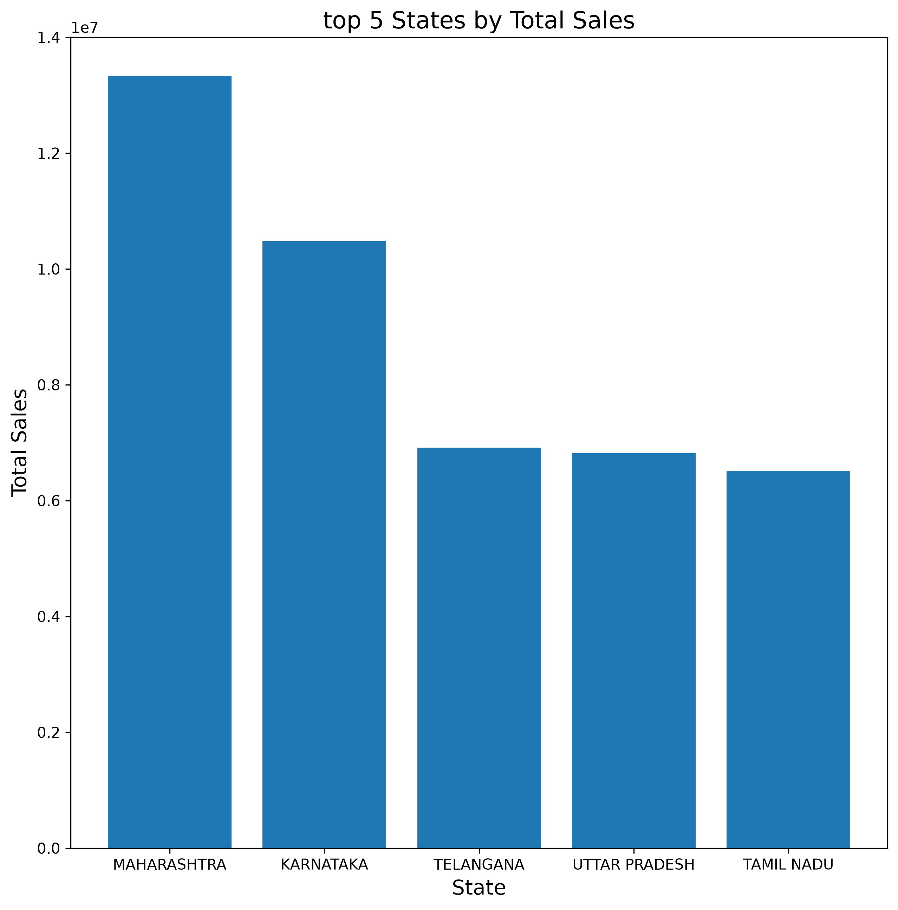

# Amazon-Sales-Analysis
My first Data ETL project
# Amazon E-commerce Sales Data Analysis 📊

## 📖 Project Overview
This is an End-to-End Data ETL (Extract, Transform, Load) and business analysis project based on a real-world Amazon e-commerce sales dataset from Kaggle (~128k rows). 

The goal of this project is to demonstrate the ability to process raw, messy data, build a local database, and extract actionable business insights using Python and SQL.

## 🛠️ Tech Stack
- **Python (Pandas)**: For data extraction, cleaning, and transformation.
- **SQLite & SQL**: For local database creation and business aggregation analysis.
- **Matplotlib**: For data visualization.

## ⚙️ Core Workflow
1. **Data Extraction**: Read the raw CSV file while skipping malformed lines to prevent memory crash.
2. **Data Cleaning**: 
   - Removed rows with missing critical values (`Amount`, `Qty`).
   - Filtered out invalid orders (e.g., `Amount <= 0`).
   - **Result**: Retained **118,837** valid records from the original 128,975.
3. **Data Normalization**: Refactored illegal column names containing hyphens (e.g., `ship-state` to `ship_state`) to ensure SQL syntax compatibility.
4. **Database Loading**: Exported the clean dataset into a local SQLite database (`company_data.db`).
5. **Business Analysis**: Utilized SQL `GROUP BY` and `SUM` aggregations to identify top-performing states.

## 💡 Key Business Insights
- **MAHARASHTRA** is the top-performing state, generating approximately **133.3 million** in total sales, followed closely by **KARNATAKA**.
- Out of 24 original columns, only 7 key business metrics (Order ID, Date, Category, Qty, Amount, State) were selected for analysis to optimize database performance.

## 📈 Data Visualization

*(Note: The chart illustrates the Top 5 states by revenue, highlighting the dominance of Maharashtra.)*

## 📂 Project Files
- `clean_data.py`: The main Python script for data cleaning, database creation, and visualization.
- `company_data.db`: The cleaned SQLite database ready for querying.
- `top5_states.png`: The visualization output.
- `Amazon Sale Report.csv`: The raw dataset (Downloaded from Kaggle).
